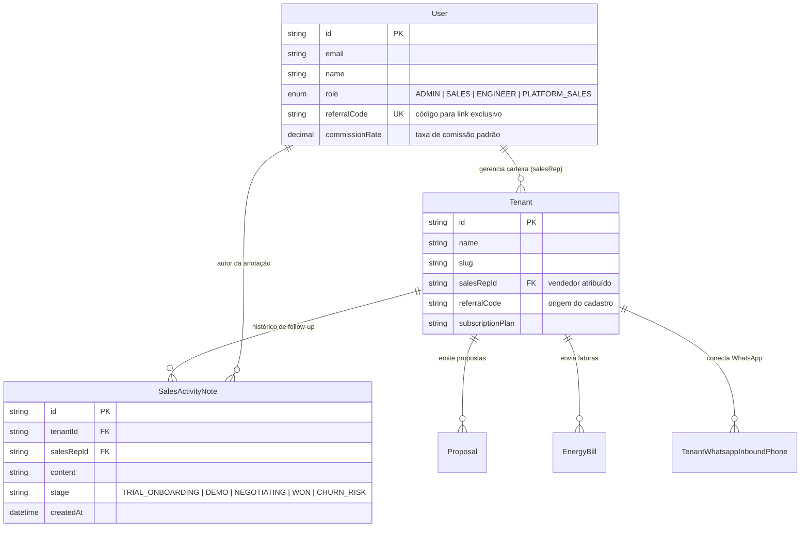
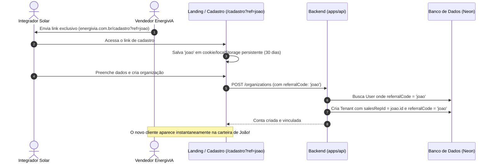

# Design Doc: Portal Comercial e Gestão de Vendedores Internos (Product-Led Sales)

**Data:** 15 de Outubro de 2026  
**Status:** Validado e Aprovado  
**Autor:** Engenharia EnergivIA

---

## 1. Contexto e Objetivo

A EnergivIA está expandindo sua operação comercial contratando vendedores internos (SDRs/Closers/Consultores) para prospectar empresas integradoras de energia solar, vender planos de assinatura e assegurar a ativação bem-sucedida das contas.

### O Desafio

- **Segregação de Perfis:** Vendedores não devem ter acesso a dados confidenciais do SaaS (como tokenomics/custos de IA em `admin/sistema`, configurações de infraestrutura, faturamento global de outros vendedores ou painel de integrador com dados fictícios).
- **Atribuição Automática (Tracking):** Cada vendedor deve possuir um link/código exclusivo (`?ref=codigo`) para que, ao criar uma conta, a empresa seja atribuída automaticamente à sua carteira.
- **Product-Led Sales (Health Score de Ativação):** O vendedor precisa acompanhar em tempo real o que o cliente está fazendo durante o Trial (ex: gerou proposta? conectou WhatsApp? enviou fatura OCR?) para atuar com agilidade no onboarding e fechar o plano anual/mensal antes do vencimento do teste.

---

## 2. Decisões Arquiteturais

### 2.1 Módulo Nativo no Monorepo (Abordagem Aprovada)

- **Localização:** Integrado em `apps/api` (módulo `sales-rep`) e `apps/web` (rotas protegidas em `/admin/comercial` ou `/comercial`).
- **Segurança RBAC:** Novo papel de usuário `PLATFORM_SALES` no banco e no token JWT.
- **Guarda de Segurança no Backend (`PlatformSalesGuard`):** Impede que usuários comuns ou integradores acessem endpoints de vendas, e restringe consultas ao escopo do vendedor logado (`WHERE tenant.salesRepId = currentUser.id`).
- **Acesso do Super Admin:** Usuários `PLATFORM` (Super Admins) possuem visão irrestrita de todos os vendedores, podendo reatribuir carteiras e visualizar o ranking de conversão.

---

## 3. Modelo de Dados (Prisma Schema)

---

## 4. Estrutura do Portal Comercial (`/admin/comercial`)

A interface foi concebida no padrão **Obsidian Dark** com acabamento em **Glassmorphism**, priorizando clareza e velocidade de ação para o vendedor:

1. **Header do Vendedor:**
   - Boas-vindas personalizadas com métricas rápidas do dia.
   - **Card de Link Exclusivo:** Botão de 1 clique para copiar o link `https://app.energivia.com.br/cadastro?ref=SEU_CODIGO` e atalho para compartilhar no WhatsApp.
2. **KPIs de Performance da Carteira:**
   - **Total de Empresas:** Quantidade de integradores na carteira.
   - **Trials em Andamento:** Contas ativas em teste com contador de dias restantes.
   - **Assinantes Pagantes:** Clientes convertidos em planos pagos.
   - **Propostas Geradas pelos Clientes:** Métrica central de ativação (quanto mais propostas o cliente gera, menor a taxa de cancelamento).
   - **Comissão Estimada do Mês:** Projeção financeira do vendedor.
3. **Tabela de Carteira & Termômetro de Ativação:**
   - **Integradora:** Nome da empresa, responsável, WhatsApp e e-mail.
   - **Plano / Status:** Badge do plano (Trial, Start, Pro, Elite) com indicação visual de dias restantes no trial.
   - **Termômetro de Uso (Health Score):**
     - Propostas: `[12 geradas]` (Badge verde se > 3, amarelo se 1-2, cinza/alerta se 0).
     - WhatsApp: `[Conectado]` ou `[Não conectado]`.
     - Faturas OCR: `[X faturas analisadas]`.
   - **Estágio no Funil:** Dropdown inline (Onboarding, Demo Realizada, Negociando Plano, Ativado, Risco de Churn).
   - **Ações Rápidas:**
     - Botão de WhatsApp: Abre conversa direta com texto pré-definido baseado no momento do cliente (ex: incentivo à 1ª proposta).
     - Botão de Notas: Drawer lateral para registrar histórico de ligações e reuniões.

---

## 5. Fluxo de Atribuição de Cadastro (`?ref=codigo`)

---

## 6. Governança e Segurança

1. **Proteção de Dados Sensíveis:** O vendedor **não** enxerga dados de outros vendedores, faturamento global da EnergivIA, configurações de infraestrutura ou custos de IA.
2. **Isolamento de Tenant:** Vendedores da plataforma EnergivIA operam no nível da plataforma (`salesRepId`), sem interferir nas permissões internas que os integradores possuem dentro de suas próprias empresas.
3. **Escalabilidade:** Toda consulta de carteira utiliza índices dedicados (`Tenant(salesRepId)` e `User(referralCode)`), garantindo respostas em milissegundos mesmo com milhares de organizações cadastradas.
