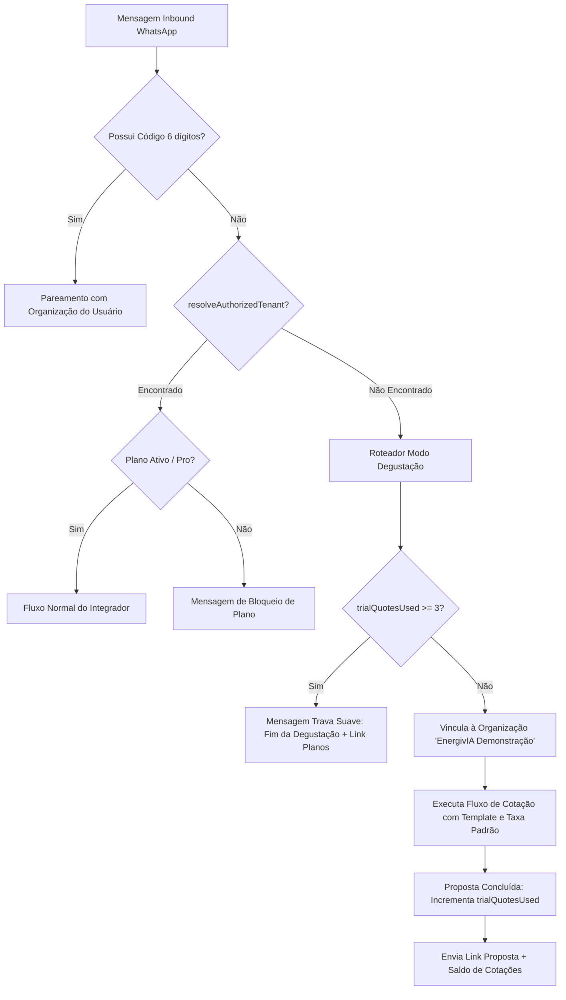

# Design Doc: Degustação Gratuita no WhatsApp para Novos Clientes (Modo Trial Sem Bloqueio)

**Data:** 19/10/2026  
**Status:** Aprovado  
**Autor:** Antigravity & Giovani

---

## 1. Contexto & Motivação

Atualmente, quando um novo integrador ou prospect entra em contato com o WhatsApp da EnergivIA sem antes ter criado uma conta e realizado o pareamento por código de 6 dígitos, o bot devolve uma mensagem de trava imediata:

> _"Olá! O assistente de inteligência artificial da EnergivIA é um recurso exclusivo para integradores parceiros credenciados... Para vincular este WhatsApp à sua conta: 1. Acesse a plataforma..."_

Essa barreira inicial impede que novos clientes experimentem o produto, gerando atrito no funil de vendas.

O objetivo deste projeto é implementar o **Modo Degustação Gratuita (Trial)** diretamente no WhatsApp da EnergivIA, permitindo que novos clientes realizem até **3 cotações solares completas** (com leitura de fatura/consumo, opções de kits, definição de preço por kWp, link público da proposta e PDF), utilizando configurações e templates oficiais padrão, sem necessidade de conta prévia e sem quebrar o fluxo existente dos clientes pagantes.

---

## 2. Requisitos & Decisões de Negócio

1. **Limite de Degustação**: Exatamente **3 cotações completas gratuitas** por número de WhatsApp.
2. **Sem Extração de Nome na Fatura**: A IA de visão e extração da conta de luz (`billExtractor`) extrai consumo (kWh), concessionária e valor, **sem tentar extrair o nome do cliente** da conta. O bot pergunta normalmente o nome do cliente final para a proposta.
3. **Menu Inicial e Opções Verticais**: Mensagens com opções numeradas (`1️⃣`, `2️⃣`, etc.) formatadas em cards (`> `), dispostas uma abaixo da outra, sem uso da palavra "Solar" após "EnergivIA" (usando sempre apenas "EnergivIA").
4. **Precificação R$/kWp**: O testador pode optar por seguir com a taxa recomendada de mercado (**R$ 2.800,00/kWp**) ou digitar livremente outro valor por kWp desejado.
5. **Modelo da Proposta**: Aplicação direta do **Modelo Oficial Padrão EnergivIA**, sem fricção de seleção de modelos no teste.
6. **Marcas e Equipamentos**: Catálogo nacional padrão dos distribuidores (Tiers Standard 🏆, Elite e Premium) com as marcas consolidadas do mercado.
7. **Conversão e Transição**:
   - A cada cotação concluída, o bot informa o progresso (ex: `Cotação [1 de 3] gerada com sucesso!`).
   - Ao atingir as 3 cotações, o bot envia a mensagem elegante de encerramento da degustação com link de contratação de plano.
   - Se o cliente criar conta na plataforma e enviar o código de 6 dígitos (`CONECTAR 123456`), o sistema realiza o pareamento imediatamente para a nova empresa dele.

---

## 3. Arquitetura da Solução



### 3.1. Organização de Sistema ("EnergivIA Demonstração")

Para preservar a integridade referencial do banco de dados (que exige `organizationId` / `tenantId` em `Conversation`, `Deal`, `Proposal`, `Simulation`, etc.), o sistema utilizará uma organização interna garantida:

- **Slug**: `degustacao-whatsapp`
- **Nome**: `EnergivIA Demonstração`
- **Plano**: `Pro / Ativo` com permissão de bot e geração de propostas habilitadas.
- **Template Padrão**: Modelo Oficial Padrão EnergivIA publicado como padrão.
- **Taxa por kWp**: `R$ 2.800,00`.

### 3.2. Controle de Cota por Telefone

- O rastreamento de cota é armazenado no `metadata` da `Conversation` e validado contra as propostas criadas para aquele número:
  ```ts
  interface GuestTrialMetadata {
    isGuestTrial: boolean;
    trialQuotesUsed: number;
    trialMaxQuotes: number;
    trialCompletedProposalIds: string[];
    customerWaId: string;
  }
  ```
- Uma cotação só é debitada quando o passo `PROPOSAL_COMPLETED` é alcançado e a proposta é salva no banco.
- Se a sessão for reiniciada pelo usuário ("novo", "reiniciar") ou expirar por inatividade de 15 minutos, o histórico de mensagens é limpo para nova cotação, mas o `trialQuotesUsed` é preservado.

---

## 4. Textos e Fluxo de Mensagens

### 4.1. Boas-Vindas da Degustação (Primeiro Contato / Opções Verticais)

```text
Olá! Tudo bem? ☀️

Sou seu assistente de vendas e dimensionamento da *_EnergivIA._*

🎁 *Você ganhou 3 cotações completas gratuitas de teste!*
_(Restam 3 cotações no seu teste gratuito)_

*_Como posso ajudar você a gerar orçamentos hoje?_*

> 1️⃣ *Enviar fatura de energia* (PDF ou foto)
> 2️⃣ *Simular por consumo mensal* (ex: `450 kWh`)
> 3️⃣ *Simular por potência de pico* (ex: `5 kWp`)
> 4️⃣ *Simular por quantidade de placas* (ex: `10 módulos`)

_(Responda com o número da opção ou envie a conta de luz diretamente)_

Equipe *_EnergivIA._*
```

### 4.2. Entrega da Proposta & Contador

```text
🎉 *Proposta Comercial Gerada com Sucesso!* ☀️

📄 *Acesse a proposta online interativa:*
👉 https://www.energivia.com.br/propostas/preview/:id

📊 *Cotação [1 de 3] gerada com sucesso!*
_(Você ainda possui 2 cotações gratuitas de teste)_

💡 *Dica:* Na plataforma você pode personalizar sua logo, modelos e margens: *https://www.energivia.com.br*
```

### 4.3. Bloqueio Educado ao Esgotar as 3 Cotações

```text
Olá! ☀️ Você já utilizou suas *3 cotações gratuitas de degustação* da EnergivIA.

Esperamos que tenha gostado da velocidade e precisão das propostas comerciais! 🚀

Para continuar gerando propostas comerciais ilimitadas com IA, personalizar o valor por kWp, usar o logotipo da sua empresa e cadastrar seus próprios clientes, escolha o seu plano em:
👉 *https://www.energivia.com.br/gestao/meus-planos*
```

---

## 5. Casos de Borda e Segurança

1. **Isolamento de Dados**: Nenhuma proposta de degustação é misturada com propostas de integradores oficiais.
2. **Solicitação de PDF Posterior**: O comando "pdf" ou "baixar pdf" após a conclusão da proposta recupera o documento gerado sem gastar uma nova cotação.
3. **Conversão Imediata**: Caso o usuário envie o código de 6 dígitos a qualquer momento, o pareamento sobrescreve o modo degustação e ativa a organização oficial do integrador.
4. **Tentativas Após 3 Cotações**: Qualquer envio de texto ou arquivo após o limite esgotado retorna a mensagem de convite aos planos, sem invocar serviços pagos de visão computacional da OpenAI/Gemini.

---

## 6. Estratégia de Testes

- **Testes Unitários da Máquina de Estados**:
  - Validar que número não autenticado entra no modo degustação com limite de 3 cotações.
  - Validar que opções de menu aparecem no formato vertical e com a saudação sem a palavra "Solar".
  - Validar que a cota é incrementada apenas quando a proposta é finalizada.
  - Validar que a 4ª tentativa é bloqueada com a mensagem de upgrade.
  - Validar que código de 6 dígitos continua pareando normalmente mesmo em número em degustação.
