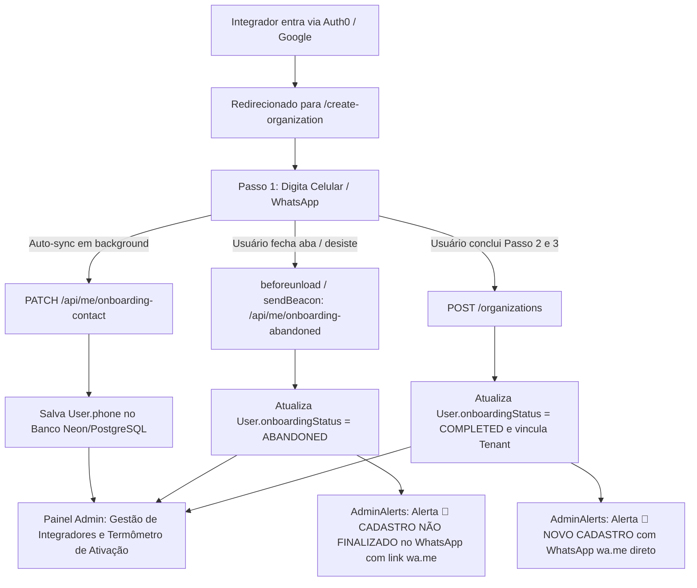

# Design: Captura de Celular do Integrador no Onboarding, Rastreamento de Abandono e Monitoramento de Inativos

## 1. Contexto & Objetivo de Negócio

Atualmente, o cadastro inicial da EnergivIA é realizado pelo Auth0 (E-mail corporativo ou Google) e redireciona os novos usuários para o fluxo de onboarding em `/create-organization`. No entanto:

1. O formulário não solicitava o número de celular/WhatsApp do integrador.
2. A equipe comercial não conseguia saber quais integradores iniciaram o cadastro mas saíram da página antes de concluir (abandono de onboarding).
3. Não havia uma forma ágil de identificar quem concluiu o cadastro mas nunca utilizou a plataforma (ex: 0 propostas geradas), para que a equipe comercial possa entrar em contato ativo via WhatsApp.

O objetivo deste projeto é:

- Adicionar o campo obrigatório de **Celular / WhatsApp** com máscara brasileira logo no **Passo 1** do Onboarding (`/create-organization`).
- Sincronizar o telefone digitado em segundo plano e disparar evento de **abandono** caso o usuário saia da página ou feche a aba antes de finalizar.
- Incluir o número de WhatsApp com link direto `https://wa.me/55...` nos alertas de novos cadastros e abandonos enviados para o grupo de WhatsApp dos administradores.
- Exibir no Painel Administrativo uma listagem de status de ativação (Abandonou Onboarding, Cadastrado Sem Uso e Ativo).

---

## 2. Arquitetura da Solução



---

## 3. Modelo de Dados (Prisma Schema)

Na entidade `User` em `apps/api/prisma/schema.prisma`:

```prisma
model User {
  // ... campos existentes
  phone                  String?
  onboardingStatus       String?   @default("IN_PROGRESS") @map("onboarding_status") // IN_PROGRESS | ABANDONED | COMPLETED
  onboardingAbandonedAt  DateTime? @map("onboarding_abandoned_at")
  lastActiveAt           DateTime? @map("last_active_at")

  @@index([onboardingStatus])
}
```

No objeto `settings` de `Tenant`, o telefone de contato comercial da empresa também é persistido para uso nos cabeçalhos de propostas.

---

## 4. Endpoints & Serviços de Backend (NestJS)

1. **`PATCH /users/me/onboarding-contact`**:
   - Atualiza o campo `phone` do usuário autenticado assim que digitado (com normalização de DDI 55 e validação de 10-11 dígitos).
2. **`POST /users/me/onboarding-abandoned`**:
   - Marca `onboardingStatus = "ABANDONED"` e `onboardingAbandonedAt = new Date()`.
   - Dispara alerta executivo no WhatsApp para a equipe via `AdminAlertsService.notifyOnboardingAbandoned()`.
3. **`OrganizationsService.create`**:
   - Marca `onboardingStatus = "COMPLETED"`.
   - Propaga o `phone` para o alerta `AdminAlertsService.notifyNewUserRegistration()`.
4. **`AdminAlertsService`**:
   - Adicionar método `notifyOnboardingAbandoned(data)` com formatação profissional e link `wa.me/55...`.
   - Atualizar `notifyNewUserRegistration(data)` para exibir o WhatsApp do integrador formatado e clicável.
5. **`UsersService.listIntegratorActivationStatus`**:
   - Retorna integradores agrupados por:
     - `ABANDONED_ONBOARDING`: Criou conta, mas não possui organização ou `onboardingStatus == "ABANDONED"`.
     - `REGISTERED_NO_USAGE`: Possui organização criada, mas tem 0 propostas criadas.
     - `ACTIVE`: Possui propostas criadas ou atividade nos últimos 30 dias.

---

## 5. Interface do Usuário (Next.js / Tailwind CSS)

1. **`/create-organization/page.tsx`**:
   - No **Passo 1 (Empresa)**, adicionar campo com máscara:
     - Label: **Celular / WhatsApp do Integrador**
     - Placeholder: `(11) 99999-9999`
     - Máscara reativa dinâmica para 10 ou 11 dígitos.
     - Ícone temático (`Phone` do Lucide).
   - Bloqueio suave: o botão "Próximo: Perfil do Integrador" exige celular válido.
   - Sincronização em segundo plano: ao completar 10-11 dígitos e desfocar (blur) ou antes de avançar, envia `PATCH /api/me/onboarding-contact`.
   - Captura de abandono: `navigator.sendBeacon` disparado no evento de saída de página (`visibilitychange` / `pagehide`) se o onboarding ainda estiver em andamento.
2. **Painel Admin (`/admin/acessos-especiais` ou aba de Ativação)**:
   - Tabela com filtros de status:
     - Badges semânticos:
       - 🔴 `Abandonou Cadastro`
       - 🟡 `Sem Uso (0 Propostas)`
       - 🟢 `Ativo`
     - Botão com ação direta "Chamar no WhatsApp" que abre `https://wa.me/55...` com mensagem pré-configurada de boas-vindas/ajuda.

---

## 6. Tratamento de Erros & Resiliência

- **Falha de rede ao sair da página:** `sendBeacon` garante a entrega mesmo após o fechamento da janela sem travar a navegação do usuário.
- **Formatação de telefone inconsistente:** Normalizador centralizado limpa caracteres não numéricos (espaços, hífens, parênteses) e garante prefixo correto no link do WhatsApp.
- **Silêncio de Alertas:** Não bloqueia o fluxo de criação da empresa caso o serviço de mensagens WhatsApp esteja offline; o alerta é assíncrono e não-bloqueante.
