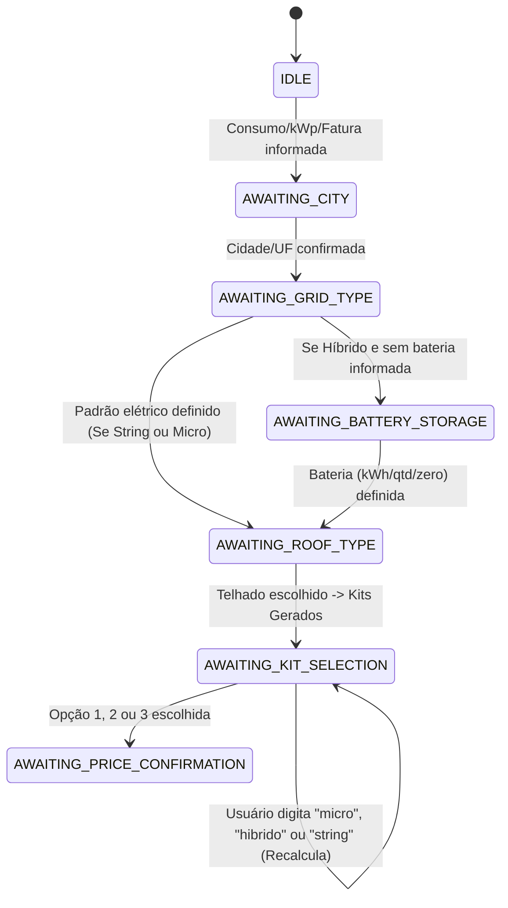

# Design Arquitetural: Cotações de Microinversor e Inversor Híbrido no WhatsApp

**Data:** 23 de Outubro de 2026  
**Status:** Aprovado  
**Autor:** Antigravity & Giovani

---

## 1. Visão Geral e Objetivos

Atualmente, o bot de simulação e cotações solares no WhatsApp ([whatsapp-bot.service.ts](file:///c:/Users/Giovani/EnergivIA/apps/api/src/modules/whatsapp/whatsapp-bot.service.ts)) gera propostas exclusivamente com inversores convencionais do tipo **String**, mesmo com o motor de cálculo do backend ([KitGenerationService](file:///c:/Users/Giovani/EnergivIA/apps/api/src/modules/kit/kit-generation.service.ts)) já possuindo métodos para microinversores e inversores híbridos.

### Objetivos Principais:

1. **Zero Atrito no Fluxo Padrão:** Não adicionar nenhuma pergunta obrigatória a mais para cotações convencionais de Inversor String (~85% dos casos), mantendo o fluxo rápido e funcional.
2. **Suporte Completo a Microinversores:** Detecção inteligente no texto livre (ex: _"10 placas com micro hoymiles"_) e recálculo instantâneo via palavra-chave `micro` na tela de kits, calculando a quantidade correta de microinversores para a potência da usina.
3. **Suporte Especializado a Inversores Híbridos:**
   - **Validação de Topologia da Rede:** Diferenciar rigorosamente Monofásico 220V (Fase + Neutro) de Bifásico 127V/220V (Fase + Fase) para garantir que o inversor híbrido ligue e opere adequadamente.
   - **Dimensionamento Aberto de Baterias:** Permitir que o integrador informe livremente em **kWh** (ex: `10 kwh`) ou em **quantidade** (ex: `2 baterias`), sem menus engessados com números que possam colidir com a quantidade.
   - **Regra Técnica Deye HV vs LV:**
     - Para inversores de **Alta Tensão (HV)**: Trava de segurança exigindo **mínimo de 4 baterias** e **BMS / Control Box incluso obrigatoriamente** na lista de materiais e no preço.
     - Para inversores de **Baixa Tensão (LV - 48V/51.2V)**: Permite 1, 2, 3+ baterias com BMS interno em cada pack.
4. **Comutação Rápida de Tecnologia:** Na lista de kits (Standard, Elite, Premium), permitir que o integrador alterne livremente entre `string`, `micro` e `hibrido` com um único comando.

---

## 2. Fluxo Conversacional e Máquina de Estados (FSM)



### 2.1 Detecção Inteligente na Entrada

No [parseIntegratorQuoteEntities](file:///c:/Users/Giovani/EnergivIA/apps/api/src/modules/whatsapp/whatsapp-bot.service.ts):

- Detecta menções a microinversores: `micro`, `microinversor`, `hoymiles`, `apsystems`, `tsun`, `delsolar micro` $\rightarrow$ seta `inverterType: "microinverter"`.
- Detecta menções a híbridos: `híbrido`, `hibrido`, `hybrid`, `deye híbrido`, `bateria`, `offgrid` $\rightarrow$ seta `inverterType: "hybrid"`.
- Detecta baterias já informadas:
  - Ex: `10 kwh de bateria`, `5kwh bateria` $\rightarrow$ `batteryKwh: 10`.
  - Ex: `2 baterias`, `4 módulos de bateria` $\rightarrow$ `batteryQty: 2`.
  - Ex: `sem bateria`, `apenas híbrido` $\rightarrow$ `batteryQty: 0`.

### 2.2 Passo Especializado para Baterias (`AWAITING_BATTERY_STORAGE`)

Caso o integrador tenha solicitado sistema híbrido mas não tenha informado a bateria no texto inicial:

```text
Qual o armazenamento de bateria desejado para este sistema híbrido? 🔋

Você pode responder em kWh, quantidade de baterias ou sem bateria:
• Ex: "5 kWh", "10.24 kWh", "15 kWh"
• Ex: "1 bateria", "2 módulos", "4 baterias"
• Ex: "0" ou "sem bateria" (apenas inversor híbrido)
```

- **Nenhum menu numérico engessado (1, 2, 3):** Elimina conflito quando o usuário responde "1" ou "2" (quantidade vs opção).

### 2.3 Regras Técnicas de Banco de Baterias (HV vs LV)

1. **Inversores Híbridos Baixa Tensão (LV - 48V/51.2V):**
   - Compatível com Deye 5kW, 8kW, etc.
   - Permite qualquer quantidade a partir de 1 unidade (1x 5.12 kWh, 2x 5.12 kWh, etc.).
   - Não requer BMS avulso.
2. **Inversores Híbridos Alta Tensão (HV):**
   - Compatível com Deye Trifásico HV (10kW+, 15kW, 20kW+).
   - **Trava de Segurança:** Mínimo de **4 módulos de bateria** (necessário para atingir a faixa de tensão operacional do barramento CC).
   - Se o usuário solicitar 1, 2 ou 3 baterias, o bot notifica e eleva para o mínimo técnico de 4 módulos.
   - **Inclusão Obrigatória do BMS:** O sistema busca automaticamente o produto da categoria `BMS` ([findActiveBms](file:///c:/Users/Giovani/EnergivIA/apps/api/src/repositories/product.repository.ts#L588)) e o inclui na lista de materiais e na precificação do kit.

---

## 3. Modelo de Dados e Persistência de Estado

### 3.1 Atualizações em [WhatsappSessionData](file:///c:/Users/Giovani/EnergivIA/apps/api/src/modules/whatsapp/whatsapp-state.types.ts)

```typescript
export interface WhatsappSessionData {
  // ... campos existentes ...
  inverterType?: "string" | "microinverter" | "hybrid" | "off_grid";
  batteryKwh?: number;
  batteryQty?: number;
  batteryVoltageType?: "LV" | "HV";
  hasBms?: boolean;
}
```

### 3.2 Atualizações em [ExtractedIntegratorQuote](file:///c:/Users/Giovani/EnergivIA/apps/api/src/modules/whatsapp/whatsapp-bot.service.ts)

```typescript
export interface ExtractedIntegratorQuote {
  // ... campos existentes ...
  inverterType?: "string" | "microinverter" | "hybrid" | "off_grid";
  batteryKwh?: number;
  batteryQty?: number;
  hasBattery?: boolean;
}
```

---

## 4. Apresentação dos Kits no WhatsApp

### 4.1 Formatação Dinâmica de Itens

Na função `formatQuotesListText`:

- **Microinversores:** Exibe explicitamente `${qty}x Microinversores ${marca} ${modelo}`.
- **Inversor Híbrido:** Exibe `1x Inversor Híbrido ${marca} ${modelo} (${tensao})`.
- **Baterias:** Se houver baterias, exibe `• ${qty}x Baterias de Lítio ${marca} (${capacidadeTotal} kWh)`.
- **BMS:** Se for sistema HV, exibe `• 1x Control Box / BMS de Cluster ${marca}`.

### 4.2 Rodapé com Alternância Rápida

Na lista de opções de kits:

```text
> 💡 Quer cotar com outra tecnologia? Envie *micro*, *híbrido* ou *string* para recalcular esta potência.
```

Se o integrador digitar:

- `micro`: Mantém os dados da usina (consumo, telhado, cidade) e recalcula instantaneamente os 3 kits como microinversor.
- `hibrido`: Transiciona para a confirmação de rede/baterias e recalcula com inversor híbrido.
- `string`: Volta para o kit convencional com inversor string.

---

## 5. Plano de Testes e Validação

1. **Testes Unitários de Extração de Mensagens:**
   - Detectar `micro` em mensagens livres ("cotação 10 placas com micro hoymiles em Maringá/PR").
   - Detectar `híbrido` e `bateria` ("800 kwh com híbrido deye e 10kwh bateria em Campinas/SP").
   - Parser de bateria por kWh (`5kwh`, `10.24 kWh`, `15kwh`) e por unidade (`1 bateria`, `2 módulos`, `4 baterias`, `sem bateria`).
2. **Testes Unitários da FSM do WhatsApp Bot:**
   - Transição para `AWAITING_BATTERY_STORAGE` apenas quando for híbrido sem bateria pré-informada.
   - Validação da trava HV da Deye (mínimo de 4 baterias + inclusão automática de BMS).
   - Recálculo por comando na tela de kits (`micro`, `hibrido`, `string`).
3. **Testes de Integração com o Motor de Kits:**
   - Verificar se `inverter_type: "microinverter"` e `"hybrid"` geram os itens corretos no `kit_items`.
   - Garantir que a proposta final em PDF e visualização web receba os equipamentos corretos de baterias e microinversores.
