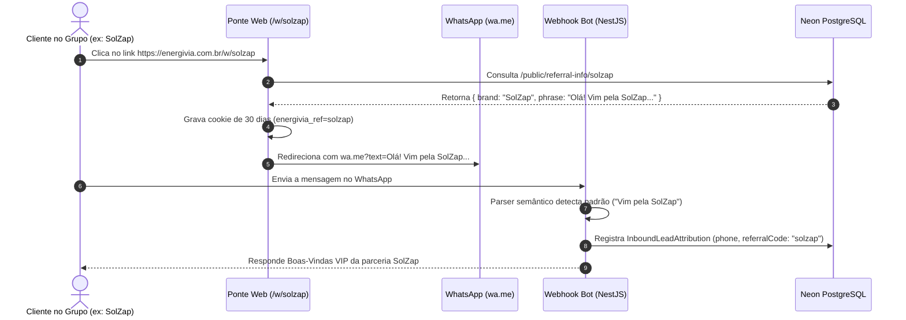

# Design de Arquitetura: Frase Humanizada e Boas-Vindas Exclusiva para Parceiros no WhatsApp

**Data:** 30 de Outubro de 2026  
**Status:** Aprovado  
**Objetivo:** Eliminar códigos técnicos visíveis como `(ref: energivia-sakp)` das mensagens de indicação do WhatsApp Bot, substituindo por frases naturais com a marca/comunidade do parceiro (ex: _"Olá! Vim pela SolZap e quero testar o assistente de IA da EnergivIA"_), com resposta de boas-vindas exclusiva e atribuição automática do lead.

---

## 1. Contexto e Motivação

Anteriormente, o link do assistente de WhatsApp para parceiros (`/w/:code`) gerava uma mensagem pré-formatada contendo uma tag mecânica entre parênteses:
`"Olá! Quero testar o assistente de IA da EnergivIA (ref: energivia-sakp)"`

Essa estrutura gerava atrito de conversão e desconforto visual:

1. Parece um código de rastreamento robótico e não uma conversa humana.
2. Leads grandes (como comunidades e empresas parceiras, ex: **SOLZAP**) que divulgam em grupos de integradores necessitam de uma comunicação profissional que reforce sua própria marca.
3. Não gerava reciprocidade na resposta inicial do robô.

Com a nova solução:

- O cliente envia uma mensagem 100% amigável destacando a marca do parceiro:
  `"Olá! Vim pela SolZap e quero testar o assistente de IA da EnergivIA"`
- O robô reconhece a parceria e responde dando as boas-vindas oficiais à parceria SolZap.
- O lead é atribuído de forma blindada à carteira do parceiro no banco de dados.

---

## 2. Visão Geral do Fluxo



---

## 3. Modelo de Dados (Neon PostgreSQL / Prisma)

No modelo `User` em `apps/api/prisma/schema.prisma` (onde residem os usuários com papel `PLATFORM_SALES` e parceiros):

```prisma
model User {
  // ... campos existentes ...
  referralCode          String?              @unique @map("referral_code")
  commissionRate        Decimal?             @default(0.10) @db.Decimal(5, 4) @map("commission_rate")
  partnerBrandName      String?              @map("partner_brand_name")       // Ex: "SolZap" ou "SOLZAP"
  referralPhrase        String?              @map("referral_phrase") @db.Text // Ex: "Olá! Vim pela SolZap e quero testar o assistente de IA da EnergivIA"
  customWelcomeMsg      String?              @map("custom_welcome_msg") @db.Text // Boas-vindas VIP personalizada
  // ... relações existentes ...
}
```

### Regras de Normalização e Fallbacks:

- Se `partnerBrandName` estiver preenchido (ex: `"SolZap"`), o fallback dinâmico de `referralPhrase` é:
  `"Olá! Vim pela SolZap e quero testar o assistente de IA da EnergivIA"`
- Se for nome pessoal (ex: `"Giovani"`):
  `"Olá! Vim por indicação do Giovani e quero testar o assistente de IA da EnergivIA"`
- Se nenhum estiver preenchido, usa o `referralCode` ou o nome do usuário como base.

---

## 4. API Pública de Informações de Indicação

Novo endpoint público com cache leve e rate limit:
`GET /public/referral-info/:code`

**Resposta:**

```json
{
  "referralCode": "solzap",
  "partnerBrandName": "SolZap",
  "referralPhrase": "Olá! Vim pela SolZap e quero testar o assistente de IA da EnergivIA",
  "customWelcomeMsg": "Olá! Seja muito bem-vindo à EnergivIA! Identificamos sua chegada através da parceria com a SolZap. Liberamos 3 propostas completas de cortesia para você testar!"
}
```

---

## 5. Parser de Indicação Semântico no WhatsApp Bot

No módulo `apps/api/src/modules/whatsapp/services/whatsapp-referral-parser.ts`:

O parser `extractReferralCodeFromText(incomingText)` é expandido para reconhecer:

1. Padrões semânticos em português:
   - `/(?:vim pela?|vim por|vi no grupo da?|indica[çc][ãa]o da?|parceiro)\s+([a-zA-Z0-9_\s-]{2,40})/i`
2. Comparação contra a base de parceiros ativos:
   - Busca por correspondência exata ou parcial de `partnerBrandName` e `referralPhrase`.
3. Compatibilidade retroativa mantida:
   - Suporte contínuo para links antigos com `#codigo`, `ref: codigo` ou `indicação: codigo`.

Ao reconhecer o parceiro:

- Cria/atualiza o registro em `InboundLeadAttribution` vinculando `fromWaId` ao `salesRepId` e `referralCode`.
- O bot envia a mensagem de saudação da parceria e inicia o atendimento (coleta do nome do integrador).

---

## 6. Página de Redirecionamento Web (`apps/web/src/app/w/[code]/page.tsx`)

- A página consome os dados de `/public/referral-info/:code`.
- Monta a URL de deep link com a mensagem natural limpa.
- Continua persistindo o cookie de 30 dias `energivia_ref` e `localStorage` no dispositivo.
- Redirecionamento instantâneo e botão de contingência caso o WhatsApp não abra sozinho.

---

## 7. Painel do Parceiro e Admin Comercial

No componente de links do parceiro (`SalesRepLinkCard.tsx`) e na gestão comercial (`/admin/comercial`):

- Exibe o link curto: `https://www.energivia.com.br/w/${code}`
- Campos de edição:
  - **Nome da Marca / Comunidade:** (ex: `SolZap`)
  - **Frase do WhatsApp:** Permite personalizar ou restaurar o modelo padrão.
  - **Mensagem de Boas-Vindas:** Permite customizar a saudação enviada pelo robô.
- Card de **Preview Visual em Tempo Real** mostrando:
  - Balão do cliente enviando a mensagem no WhatsApp.
  - Balão do robô respondendo com a saudação exclusiva.

---

## 8. Estratégia de Testes

1. **Testes Unitários:**
   - `whatsapp-referral-parser.spec.ts`: Testar extração de padrões como `"Vim pela SolZap"`, `"Vi no grupo da SolZap"`, `"Vim pelo Giovani"`, com variações de maiúsculas/minúsculas e pontuação.
   - `sales-rep.service.spec.ts`: Testar persistência dos novos campos e geração de fallbacks.
   - `whatsapp-bot.service.spec.ts`: Testar disparo da resposta de boas-vindas personalizada quando há parceiro detectado.
2. **Testes de Integração e Rota:**
   - Testar endpoint `GET /public/referral-info/:code`.
   - Testar redirecionamento e persistência de cookies na rota `/w/[code]`.
3. **Validação de Build:**
   - Compilação limpa do NestJS e Next.js.
